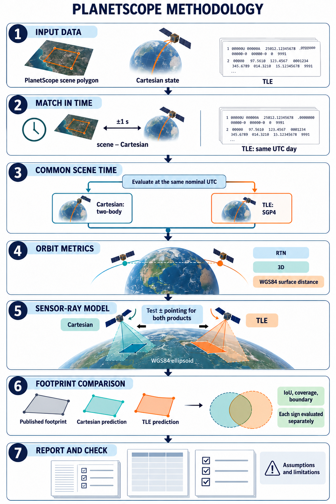

# PlanetScope orbital and footprint consistency

This MATLAB project compares Planet's published Cartesian state vectors and
TLEs at PlanetScope acquisition times. It also projects a conditional sensor
footprint from each orbit and compares both polygons with the published scene
footprint. The outputs describe **consistency between products**; neither an
orbital product nor an image footprint is established as independent ground
truth.

The project uses real input data. Reports, tables and figures are generated by
each run under `results/`; a fresh checkout does not contain research results.
See the [methodology](docs/FOOTPRINT_METHODOLOGY.md) for the scientific
motivation, equations and detailed references.

## Requirements

- MATLAB R2024b or later, with a working Java runtime, Aerospace Toolbox and
  Mapping Toolbox. The image-epoch workflow uses MATLAB's
  [`propagateOrbit`](https://www.mathworks.com/help/aerotbx/ug/propagateorbit.html)
  and WGS84 geodesic and projection functions.
- Planet Cartesian `.states` and TLE archives for the study period. A Planet
  Data API key and internet access are needed for a new PSScene catalogue
  search; catalogue visibility depends on the account.
- Observed Earth-orientation data. The workflow downloads or reuses a cached
  USNO/IERS file and records its hash. The configured leap-second validity must
  cover the requested dates; review it against the [USNO announcement](https://maia.usno.navy.mil/products/leap-second)
  before extending the year beyond the configured range.

MATLAB must be installed and licensed separately from Planet. See the
[installation, activation, Java and terminal guide](docs/MATLAB_SETUP.md).
No Python installation is needed.

## Prepare the inputs

### Orbital archives

Place the original daily Planet files in `data/raw/`, either directly or in
`YYYY/MM/` subdirectories. Keep their native names, for example:

```text
data/raw/planet_20260301.states
data/raw/planet_mc_20260301.tle
```

When `data/raw/` is absent, the configuration also recognizes the existing
`data/planet_ephemerides/raw/daily/YYYY/MM/` layout. The quick-look search
only queries windows around usable local state epochs: choosing a year does
not create records for missing days. The archive inventory records coverage,
provenance and parsing problems. See [Planet's ephemeris documentation](https://ephemerides.planet-labs.com/)
for the native products and the [data dictionary](docs/DATA_DICTIONARY.md)
for the project fields.

To acquire and inspect public orbital archives from MATLAB before the image
search, configure the audit workflow. The example requests all of 2026 plus
guard days; availability depends on the source and a full-year download can
take time.

```matlab
startup_consistency
cfg = study_config("audit");
cfg.study.startUTC = datetime(2026,1,1,'TimeZone','UTC');
cfg.study.endUTC = datetime(2026,12,31,'TimeZone','UTC');
cfg.download.enabled = true;
audit = run_study(cfg);
```

The audit stops after source acquisition, parsing and orbital-product pairing;
it does not run the footprint analysis. Inspect its archive manifest and report
for unavailable dates. Existing source files are cached rather than overwritten.

### Planet API key

Copy `.env.example` to `.env` in the repository root and set:

```text
PLANET_API_KEY=your_planet_api_key
```

The file is ignored by Git. A nonempty `PLANET_API_KEY` in the MATLAB process
environment takes precedence. Do not put the key in MATLAB scripts or results.
For alternative setup and permissions, see the [quick-look guide](docs/QUICKLOOK.md)
and [Planet authentication](https://docs.planet.com/develop/authentication/).

## Run the acquisition and footprint study

From the repository root in MATLAB:

```matlab
startup_consistency
opts = footprint_study_config(2026);
result = run_footprint_study(opts);
disp(result.RunDir)
```

The default study searches the specified UTC calendar year using all usable
local satellite records. It retains all same-satellite scene/state/TLE
combinations within **±1 s** between the scene and Cartesian epoch, with a
TLE native epoch on the **same UTC date** as the scene. It initially analyses
finalized, standard, ground-controlled PSB.SD scenes; the match inventory
records exclusions. A same-day TLE is not necessarily within one second or
earlier than the scene.

The runner reuses a compatible saved quick-look search by default. If available,
it can also match a local input-only PSScene snapshot at
`data/planet_psscene/catalogue_2026.mat` against the current local orbital
archives without an API key. The snapshot is ignored by Git and is not included
in a fresh checkout. It contains only the catalogue searches and orbital time
windows covered when it was created, and may omit newer records. If no
compatible cached source is found, the runner searches Planet using the local
orbital archives and API key. Set `opts.ReuseQuicklook = false` to force a
fresh search, or set `opts.QuicklookMAT` to a compatible saved
`quicklook_results.mat`. Do not put credentials in `opts`.

For a nondefault raw-archive path, run the quick look explicitly, then pass
its MAT output to the footprint runner:

```matlab
q = quicklook_config();
q.RawPath = "path/to/orbital/archives";
q.TimeToleranceSeconds = 1;
q.DownloadThumbnails = false;
search = quicklook_inspector(q);

opts = footprint_study_config(2026);
opts.QuicklookMAT = fullfile(search.RunDir, "quicklook_results.mat");
result = run_footprint_study(opts);
```

`quicklook_config` itself defaults to **60 s** and downloads thumbnails; the
example explicitly selects 1 s and disables thumbnails. Its dates default to
2026 and can be changed with `q.StartUTC` and `q.EndUTC`. For an optional
smaller exploratory run, set `opts.MaxMatches` to a finite number and report
that subset when interpreting its results.

From a terminal in the repository root, the default workflow can also be
started with `matlab -batch "startup_consistency; result=run_footprint_study(footprint_study_config(2026));"`.

## Analysis process

The tables distinguish what the MATLAB code does from assumptions and known
limitations. Equations, model definitions and further references are in the
[methodology](docs/FOOTPRINT_METHODOLOGY.md); proposed extensions there are
labelled separately from the implemented workflow.



*Conceptual workflow for one matched satellite and scene, not analysis results.
The snapshot is the baseline; sampled swept mode is optional and requires a
specified instantaneous field of view and acquisition duration. Pointing
assumptions are applied in each product's separately constructed local frame.*

### 1. Prepare input data

| Process | Approach | Assumptions | Limitations |
|---|---|---|---|
| Source inventory | • Parse local Planet state and TLE archives and identify the available scene catalogue or cache.<br>• Retain source hashes, scene geometry, angles, quality, satellite and strip IDs. | • Inputs follow the expected native formats.<br>• A cached catalogue represents the original search windows. | • Missing archives or catalogue windows give incomplete coverage.<br>• A cached snapshot may miss newer data. |

### 2. Match in time

| Process | Approach | Assumptions | Limitations |
|---|---|---|---|
| Match and select | • Search [PSScene metadata](https://docs.planet.com/data/imagery/planetscope/psscene/) around available state epochs.<br>• Keep every same-satellite combination within ±1 s of the scene's Cartesian epoch and with a TLE epoch on the scene's UTC date.<br>• Initially select finalized, standard, ground-controlled PSB.SD scenes. | • The catalogue `acquired` value is the nominal acquisition time.<br>• Header and roster IDs are used as identity evidence. | • The TLE may be more than one second away or later than the scene.<br>• Scene time is not established as the exact exposure time of every pixel.<br>• Historical identity may be unverified. |

### 3. Evaluate both orbits at a common scene time

| Process | Approach | Assumptions | Limitations |
|---|---|---|---|
| Propagation | • Evaluate both products at the same nominal scene UTC.<br>• Propagate the Cartesian state with two-body numerical `ode113` and the TLE with [SGP4](https://celestrak.org/publications/AIAA/2006-6753/). | A short-arc, two-body propagation is an acceptable baseline for the selected Cartesian time gap. | • Product differences also include differences between propagators.<br>• Later-epoch TLEs make the comparison retrospective.<br>• The baseline is not the orbit fit in [Foster et al. (2015)](https://arxiv.org/abs/1509.03270); that paper does not establish the provenance of current files. |
| Common reference frames | Transform the evaluated states to Earth-fixed coordinates using the same Earth-orientation inputs. | • The pilot treats Planet's J2000-labelled Cartesian axes as ICRF.<br>• It uses reviewed leap seconds and observed Earth-orientation data. | The J2000 interpretation, historical satellite identities and SGP4 implementation need independent verification before research conclusions. |

### 4. Calculate orbital discrepancies

| Process | Approach | Assumptions | Limitations |
|---|---|---|---|
| RTN and 3D | • Compute signed **TLE minus Cartesian** radial, transverse and normal components in a Cartesian-derived inertial RTN basis.<br>• Calculate the 3D Earth-fixed position separation. | • The Cartesian state defines a nondegenerate RTN basis.<br>• Both products share the stated epoch and frame policy. | These are product-and-model discrepancies, not errors against independent orbit truth. |
| WGS84 position | • Convert both positions to geodetic latitude, longitude and ellipsoidal height.<br>• Calculate surface geodesic distance between their ellipsoid-normal subsatellite points and east/north components from distance and bearing. | WGS84 and ellipsoid-normal subsatellite projection are the adopted reference. | • Surface separation is different from the 3D spacecraft separation.<br>• It is not an image-centre or image-geolocation error. |

### 5. Model sensor rays and reconstruct a snapshot footprint

| Process | Approach | Assumptions | Limitations |
|---|---|---|---|
| Pointing | • Use the magnitude of catalogue `view_angle` across track; test `-1` (left) and `+1` (right) relative to the forward Earth-fixed ground track.<br>• Apply both signs to both products. | • Along-track pointing and detector roll are zero.<br>• Neither sign is selected separately for a product. | • Signs are hypotheses, not measured attitude.<br>• `satellite_azimuth` is recorded but not used until its convention is verified.<br>• Solar angles do not constrain pointing. |
| Sensor extent | • Convert an assumed 19.6 km along-track by 32.5 km cross-track rectangular scene size to angular widths at a 475 km reference altitude.<br>• Trace rays from each propagated spacecraft position and altitude. | • The dimensions follow [Planet's nominal PSB.SD scene size](https://docs.planet.com/data/imagery/planetscope/).<br>• Axis assignment and the rectangular effective frame are assumed. | Delivered scene dimensions are not a calibrated instantaneous detector field of view. |
| Ray projection | • Construct each product's local frame from its position and ground-relative velocity and intersect its boundary rays with WGS84.<br>• Do not fit or translate to the published polygon or its centre. | • Both products use the same numeric pointing and sensor settings.<br>• Rays intersect the ellipsoid at zero ellipsoidal height. | • Separate local frames can give different Earth-fixed ray directions, so footprint differences include modelled orientation as well as position.<br>• Terrain, calibrated attitude, scan geometry, orthorectification, clouds and usable-data masks are not modelled. |

#### Optional time-swept swath

| Process | Approach | Assumptions | Limitations |
|---|---|---|---|
| Swept area | With `opts.Mode = "swept"`, evaluate both products at shared sample times and union the instantaneous projected footprints. | • Supply defensible `opts.InstantaneousFOVAlong_deg`, `opts.InstantaneousFOVCross_deg` and `opts.SweepDuration_s`.<br>• Choose and test `opts.SweepSamples`. | • Discrete samples do not establish continuous coverage.<br>• The nominal delivered-scene size is not an independently measured instantaneous detector FOV.<br>• Sampling convergence must be checked. |

### 6. Compare footprints

| Process | Approach | Assumptions | Limitations |
|---|---|---|---|
| Polygon comparisons | • For each sign, compare Cartesian versus published, TLE versus published, and Cartesian versus TLE predicted polygons.<br>• Calculate intersection, both coverage fractions, IoU, symmetric difference and area ratio. | Compare the full published polygon at the nominal scene time with each conditional prediction using a shared WGS84 equal-area projection. | • The delivered boundary may reflect image processing.<br>• Overlap is geometric consistency, not independent orbit accuracy or cloud-free usable coverage. |
| Boundary distances | • Calculate directed median and P95 boundary distances and a symmetric P95 summary.<br>• Use 250 m boundary sampling by default. | Local projected distances and the configured sampling provide useful approximations at scene scale. | • Distances are projected approximations.<br>• Check edge, boundary and swept-time sampling convergence. |

### 7. Report and interpret

| Process | Approach | Assumptions | Limitations |
|---|---|---|---|
| Outputs | • Export matching and status tables, per-match and summarized metrics, figures and a run report.<br>• Keep the two pointing signs separate. | The recorded input snapshot and model options describe the run. | A completed run can contain excluded or failed combinations; inspect its inventory and status before interpreting summaries. |
| Sensitivity and independence | • Vary matching tolerance, pointing and supported sensor settings in explicitly configured runs.<br>• Account for satellite, date and strip in later interpretation. | Scenarios are predeclared and applied consistently to both products. | • Sensitivity studies are not automatic.<br>• Acquisition-time bias, terrain and alternative force models are not implemented in this runner.<br>• Adjacent images and matched combinations are not necessarily independent observations. |

## Read and reproduce a run

`result.RunDir` points to the timestamped output directory. Start with
`RUN_REPORT.md` and `analysis_status.csv`; a completed run can include
failed combinations. The main outputs are:

| Output | Contents |
|---|---|
| `matching_inventory.csv`, `archive_coverage.csv` | Candidate combinations, selection reasons and available archive dates |
| `orbital_metrics.csv`, `orbital_summary.csv` | Per-match RTN, 3D and WGS84 discrepancies and summaries |
| `footprint_metrics.csv`, `footprint_summary.csv` | Per-match and summarized polygon comparisons by pointing sign |
| `footprint_results.mat` | Configuration, input provenance, metrics and modelled geometry |
| `*.png` | Timing, RTN, geographic pairs and paired footprint figures |

CSV timestamps are rounded to six fractional digits for inspection. The MAT
file retains the native timing values used by the analysis; printed precision
does not establish physical acquisition-time accuracy. Recreate figures from
an existing MAT result without querying or propagating again:

```matlab
regenerate_footprint_figures(result.RunDir)
```

## Separate Cartesian-epoch study and tests

`run_study` is a separate staged orbital-consistency workflow. Its research
profile uses a **1 ms** primary orbital-pairing window and a separate 24-hour
sensitivity sample; these are not the image-matching rules above. To use it,
review the [research protocol](docs/RESEARCH_PROTOCOL.md), then configure
`study_config("research")` and call `run_study(cfg)`. Research mode requires
reviewed identity, frame and SGP4 evidence. The [analysis guide](docs/ANALYSIS_GUIDE.md)
describes its stages and outputs.

Run the MATLAB tests with:

```matlab
startup_consistency
testResults = run_tests;
```

Some toolbox- or local-cache-dependent tests are conditional. Passing tests
checks the implementation; it does not independently validate orbit or image
accuracy.

The real-input integration tests re-read the local catalogue and orbital
archives and can take several minutes. They are skipped by default. To run
them explicitly when those inputs are available:

```matlab
setenv('POC_REAL_DATA_TESTS','1');
runtests('tests/test_footprint_integration.m')
setenv('POC_REAL_DATA_TESTS','');
```

| Problem | Check |
|---|---|
| MATLAB is unavailable or a toolbox cannot be loaded | Check the executable, activation, toolbox licences and Java setup in the [MATLAB guide](docs/MATLAB_SETUP.md). |
| Planet search cannot authenticate | Confirm the key belongs to the current Planet account and that `.env` or the MATLAB environment contains `PLANET_API_KEY`. |
| No matching scenes | Check archive date coverage, the configured year and tolerance, catalogue visibility and `matching_inventory.csv`; the workflow does not invent records for missing days. |
| A date exceeds leap-second coverage or Earth orientation is unavailable | Review the configured leap table and obtain a suitable observed EOP file; inspect the reported error and input coverage. |
| A combination or figure is missing | Inspect `analysis_status.csv`, selection reasons and `RUN_REPORT.md`; invalid inputs or geometry are flagged. |

See the [documentation index](docs/README.md),
[source notes](docs/SOURCES.md) and [licence notice](NOTICE.md). Code is
MIT-licensed; Planet-derived data have separate attribution and licensing terms.
